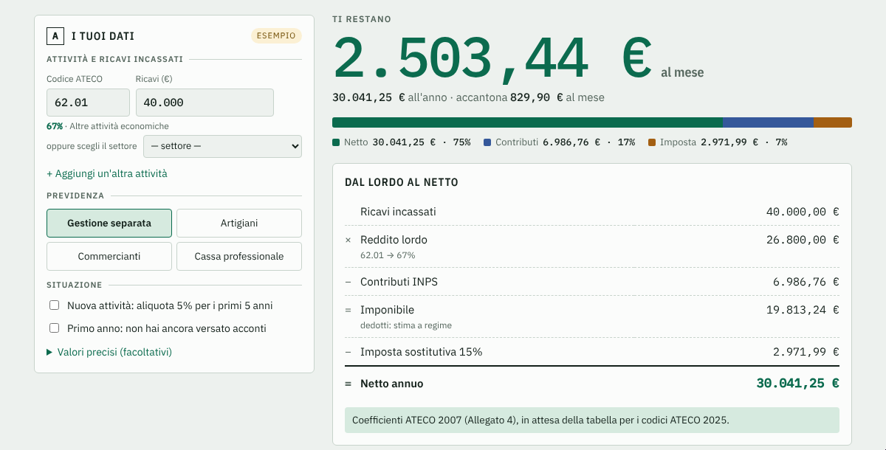

<h1 align="center">🧾 forfettario-kit</h1>
<p align="center"><b>Italian flat-rate tax (regime forfettario) calculator: taxes, INPS contributions, monthly net and advances in one command.</b></p>
<p align="center"><a href="README.it.md">🇮🇹 Italiano</a> · 🇬🇧 English · <b><a href="https://mrjonam91.github.io/forfettario-kit/">▶ Open the web app</a></b></p>
<p align="center">
  
  <br><sub>40,000 € of revenue, ATECO 62.01, Gestione separata: what you really keep, in under a second.</sub>
</p>
<p align="center">
  <a href="https://github.com/MRJonam91/forfettario-kit/actions/workflows/ci.yml"></a>
  <a href="LICENSING.md"></a>
  = 22.18" src="https://img.shields.io/badge/node-%3E%3D22.18-339933?logo=nodedotjs&logoColor=white">
  
  
  
</p>

## 🧭 What it is

If you are a freelancer in Italy under the *regime forfettario*, your bank balance lies to you: part of every invoice belongs to INPS and to the tax office, and you only find out in June. **forfettario-kit** answers "how much is really mine?" from the terminal, with the official 2025 and 2026 parameters.

- **Profitability coefficient** from your ATECO code (Allegato 4, L. 190/2014) or, if you don't know it, from your **sector**; also with **several activities** in the same year.
- **INPS 2025 and 2026**: Gestione separata 26.07%, craftsmen and traders (fixed contributions + brackets, **35%** or **50%** reductions, lower cap for pre-1996 contributors), custom professional fund.
- **Substitute tax 15%** or **5%** for start-ups, with contributions deducted on a cash basis.
- **Yearly and monthly net**, how much to **set aside every month**, effective tax rate.
- **F24 payment schedule**: every due date of the following year with **tax codes and INPS reasons** (1790/1791/1792, PXX, AF/AP, CF/CP), weekends and holidays already shifted, first-year mode, overpaid advances as **credits**, the **30/07 +0.40%** option and a **calendar file (.ics)** with 3-day reminders.
- Warnings on the **85k / 100k** thresholds (with how much you can still invoice) and the **35k** employment income limit.
- **Web app** for non-developers: same engine, a single static page, nothing leaves your browser.
- **Zero runtime dependencies**, no network calls, JSON output, Italian or English.

## 🖥️ Web app

**[mrjonam91.github.io/forfettario-kit](https://mrjonam91.github.io/forfettario-kit/)**: fill in revenue and ATECO code, read your monthly net and the F24 payments, add them to your calendar. Built from the same core by `npm run build:web` into one self-contained HTML file (`site/index.html`, also attached to every release) that works offline. A strict Content Security Policy blocks every network request: your numbers never leave the browser.

<p align="center"></p>

## 🚀 Quick start​‌​​‌‌​‌​‌​‌​​‌​​‌​​‌​‌​​​‌‌‌​​‌​​‌‌​​​‌​​‌​‌‌​‌​‌‌​​‌‌​​‌‌​‌​‌‌​​‌​‌‌​‌​‌‌​​​‌​​​‌‌​‌​​​​‌‌​​​‌​‌‌​​‌​‌​​‌‌‌​​‌​‌‌​​​‌‌

```bash
npx forfettario-kit 40000 --ateco 62.01                    # professional, Gestione separata
npx forfettario-kit 30k --ateco 47.91 -g commercianti --riduzione 35 --startup
npx forfettario-kit --ateco 62.01:30000 --ateco 47.91:12000 --json
npx forfettario-kit ateco 69.20.11                         # coefficient of a code
npx forfettario-kit 40000 -a 62.01 --scadenze --ics f24.ics # F24 schedule + calendar file
npx forfettario-kit 55000 --settore professioni --anno 2025 -s # no ATECO code, 2025 income
npx forfettario-kit settori                                # sectors and coefficients
```

Useful options: `--scadenze` F24 payments of the following year, `--ics <file>` calendar file, `--primo-anno` first year of activity, `--dedotti <euro>` contributions actually paid this year (default: steady-state estimate), `--spese <euro>` real costs for the net in your pocket, `--cassa-aliquota 14 --cassa-minimo 2000` for professional funds, `--ante-1996` lower IVS cap, `--lang en`, `--anno 2025`. Everything else: `npx forfettario-kit --help`.

As a library:

```ts
import { calcola, caricaAnno } from "forfettario-kit";

const r = calcola(caricaAnno(2026), {
  attivita: [{ ateco: "62.01", ricavi: 40000 }],
  gestione: "separata",
});
console.log(r.netto, r.acconti); // 30041.25 { dovuti: true, prima: 1188.8, seconda: 1783.19 }
```

## 🗂️ Data sources · ⚠️ Limits

Parameters live in [`data/years/`](data/years/) (2025, 2026), each with its source in [docs/DATA_SOURCES.md](docs/DATA_SOURCES.md): L. 190/2014, 2025 and 2026 Budget Laws, INPS circulars 27 and 38 of 2025, 8 and 14 of 2026.

- Coefficients follow the ATECO 2007 mapping of Allegato 4, still in force while the table for ATECO 2025 codes is pending.
- Without `--dedotti` the contributions deducted are assumed equal to those of the year (steady state). In your first year you deduct only what you actually paid.
- Professional funds (Inarcassa, ENPAP, …) are supported with your own rate and minimum, not with each fund's full rules yet.
- **This is an estimate, not tax advice.** Check with your accountant before paying anything.

## ✅ Quality

`npm run check` runs typecheck, unit tests and the core size guard; `npm run test:e2e` builds the web app and runs Playwright on desktop and mobile with an axe accessibility scan. In CI: Node 22 and 24, coverage, `npm pack` check, e2e. Beta status and test report: [docs/BETA.md](docs/BETA.md).

## 🧱 Architecture & roadmap

The core (`src/core/`, ~460 lines, no I/O) is a pure function: `calcola(rules, input)`. Yearly rules are JSON, so **a new year is a data file, not code**. See [docs/ARCHITECTURE.md](docs/ARCHITECTURE.md) and [docs/ROADMAP.md](docs/ROADMAP.md).

## 🤝 Contributing

Good first issue: **full rules for one professional fund** (e.g. Inarcassa or ENPAP) in `calcolaContributi`, with a hand-computed test. Read [CONTRIBUTING.md](CONTRIBUTING.md); external contributions require the [CLA](CLA.md).

---

⭐ If it saved you a spreadsheet, a star helps other freelancers find it.

## ❤️ Support this project

IT — Se questo progetto ti fa risparmiare tempo, puoi offrirmi un caffè.
EN — If this project saves you time, you can buy me a coffee.

[](https://github.com/sponsors/MRJonam91)
[](https://ko-fi.com/mrjonam)
[](https://buymeacoffee.com/mrjonam)
[](https://paypal.me/manorollo)

## 📄 License

Code: [AGPL-3.0-only](LICENSE) — using it in a closed product or SaaS? A [commercial license](COMMERCIAL-LICENSE.md) is available. Docs: CC BY-SA 4.0. Details in [LICENSING.md](LICENSING.md).

Copyright (c) 2026 Manoj Rollo ([@MRJonam91](https://github.com/MRJonam91))
